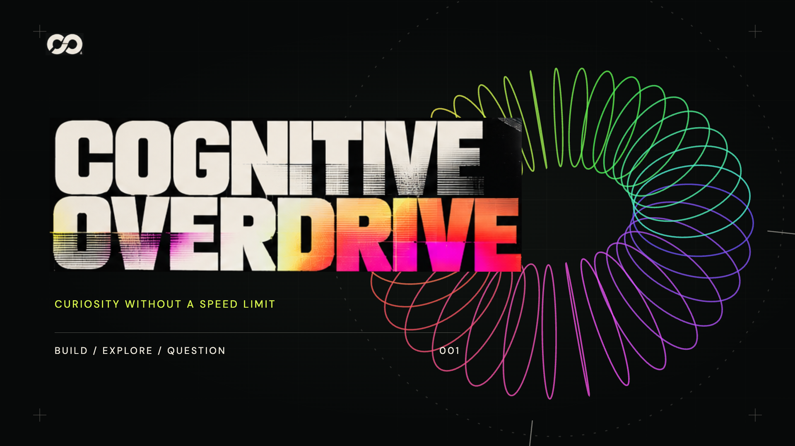

# Cognitive Overdrive

Jonathan Kershaw’s interactive portfolio and a reusable React presentation framework for explaining complex systems through a clear audience decision.

The default experience follows a seven-act adaptation of Joseph Campbell’s hero journey. It connects 27 source-backed cases across Applied AI, Platforms, Enablement, Governance and Research, with four audience lenses: C-suite, solution architects, sales and internal teams.



This public repository is configured as a GitHub template. [Download the revised 1080p MP4](https://github.com/jkershawrh/cognitive-overdrive-framework/releases/download/v0.2.0/cognitive-overdrive-portfolio-v2.mp4) or open [release v0.2.0](https://github.com/jkershawrh/cognitive-overdrive-framework/releases/tag/v0.2.0) for captions. Revision 2 includes a cinematic player, original branding and music, and a speech-timed, deterministic frame-rendering pipeline. The [first release](https://github.com/jkershawrh/cognitive-overdrive-framework/releases/tag/v0.1.0) remains available as the earlier guided-interface recording. Revision-2 export checks are recorded in [the revision audit](docs/REVISION-2-AUDIT.md).

## Run locally

Use Node.js 22.15+ and npm.

```sh
npm ci
npm run dev -- --host 127.0.0.1
```

Open the local URL printed by Vite for the guided portfolio; add `?film=1` for the cinematic player. Start playback to enable sound. The portfolio needs no model endpoint, account credential or running case-study backend.

To validate and build:

```sh
npm run check
npm run test:visual
npm run preview -- --host 127.0.0.1
```

The production output is `dist/`. Serve it from the web root; current asset references begin with `/`. External GitHub source links require network access, while bundled visual and narration assets are served locally.

## The experience

1. **The possibility — ordinary world.** Begin with the human problem and the moment an idea becomes understandable.
2. **The decision — call to adventure.** Choose the audience and the decision the room needs to make.
3. **The work — meeting the guide.** Inspect what was built, who it serves, how it works and what others can reuse.
4. **The architecture — crossing the threshold.** Ask a question before revealing the system boundary that answers it.
5. **The proof — the trials.** Change a prerequisite and inspect a deterministic browser simulation.
6. **The multiplier — the reward.** Show the handoff from one presentation to briefings, demos, architecture and enablement.
7. **The return — return with the elixir.** Leave with a concrete next step and an accurate account of the current session.

The viewer owns the decision. The engineer guides them through the mechanism, evidence and next step.

Use the chapter buttons or **← / →** to navigate, **P** for presenter notes, **F** for fullscreen and **Home** to restart. Project dialogs support search and category filtering. The **CC** control opens the chapter transcript; narration starts only after a user action.

## Reuse the framework

Content, presentation state and assets have separate entry points:

- `src/demo.config.ts` selects the active story.
- `src/portfolio/story.ts` defines identity, seven chapters, presenter notes and audience lenses.
- `src/portfolio/projects.ts` supplies the case library. The work chapter features Bake Off, Edge, AERIS, Triforce, Launchpad and Praxis, ordered by audience lens.
- `src/portfolio/PortfolioEngine.tsx` owns guided navigation, dialogs, session state and the default scene layouts.
- `src/portfolio/Cinema.tsx` presents the cinematic scenes against one shared playhead.
- `narration/cinematic-beats.json` connects short visual statements to exact spoken phrases; the timeline builder resolves their timestamps.
- `src/portfolio/Brand.tsx` displays the original CO mark and wordmark using their source crop geometry.
- `src/framework.ts` exports the engine, types and extension components.
- `public/` contains images, fonts and narration assets.
- `data/portfolio-evidence.json` retains dated, public-safe provenance and maturity boundaries.

Start with [the adaptation guide](docs/FRAMEWORK.md) and [the minimal story example](examples/minimal-story.ts). Replace the story configuration for a different audience or body of work. Use the `renderChapter` extension when a chapter needs a different visualization or interaction. The default scenes contain Cognitive Overdrive’s personal portfolio copy and visual identity; a full rebrand also changes those scene treatments and theme assets.

The implementation adapts mechanics from the existing `demo-story-starter` pattern. Cognitive Overdrive supplies this portfolio’s personal identity and presentation treatment. Brand assets retained from earlier demos do not imply an endorsement of the portfolio.

## What runs here

The React/Vite application offers a guided portfolio and a cinematic presentation. The cinematic cut uses **56 speech-timed visual beats** across the same seven-act journey, with the original ten-second brand opening, continuous music under narration, original project excerpts, animated system flows and three labeled concept renders. The current authored timeline is **330.94 seconds** (about 5:31).

The original intro and portfolio motion include projected 3D geometry; compute, Edge and Launchpad concept renders are raster artwork animated within the presentation. Original Edge and Bake Off clips show recorded project experiences. AERIS uses its existing rehearsal screenshot. These visuals do not execute the underlying systems or establish physical hardware qualification.

Intel, AMD, Arm and NVIDIA form a cross-hardware story with separate evidence levels: documented reference execution, retained historical runs, release packaging and outstanding native qualification. Launchpad makes the organizational handoff explicit: request, provision, validate, participant handoff and reclaim. See the [hardware and delivery evidence](data/hardware-evidence.json).

The revision-2 export is `output/v2/cognitive-overdrive-portfolio-v2.mp4`, with aligned English SRT and WebVTT captions. `scripts/render-frames.mjs` renders **9,929 exact-time browser frames** for the current timeline, at 1920 × 1080 and 30 fps, then encodes H.264 video with stereo AAC audio. It retains the existing Kersh ElevenLabs voice takes and mixes the original Cognitive Overdrive theme, quieter underscore and closing sting. The final AAC measures -16.04 LUFS and -1.38 dBTP; all 9,929 frames passed decode and timing checks. See the [verification record](data/revision-2-verification.json) for the inspection scope and listening limit. The full film can also be rendered as three verified sections and joined with one continuous soundtrack; the [three-part workflow](docs/VIDEO.md#render-three-sections-and-assemble-one-film) documents the exact commands. See [the video runbook](docs/VIDEO.md), [audio guide](docs/AUDIO.md) and [brand provenance](docs/BRAND.md).

The proof chapter performs deterministic checks in the browser. It produces **SIMULATION** records and can export the current session as JSON. It does not invoke a model, a Triforce service, a cluster or a real transaction. Session state is held in memory and resets on a page reload.

See [the evidence guide](docs/EVIDENCE.md) for source states and [the framework guide](docs/FRAMEWORK.md#adding-a-live-adapter) before connecting an external service.

## Maintain the story

Keep case copy and `data/portfolio-evidence.json` aligned. Preserve the distinction between implemented services, reference implementations, rehearsal candidates and research. Link only public sources that can support the case; leave the source link absent when access is not confirmed.

Run `node scripts/validate-story.mjs` after content edits. It checks the seven chapters, four audience lenses, project references, required copy, categories, source URLs and available narration assets. `npm run check` adds behavior checks, type checking, the production build and local-asset verification.

Narration settings and generation provenance belong to the narration manifest and narration documentation. Older research voice presets are deliberately excluded from the case inventory.

The first release's recorded checks apply to v0.1.0. Revision-2 build, browser, frame-rendering, encoded-audio and sampled-image results are recorded against the current artifact; see [the revision audit](docs/REVISION-2-AUDIT.md). A successful mix or render preflight does not establish a finished-film review.
